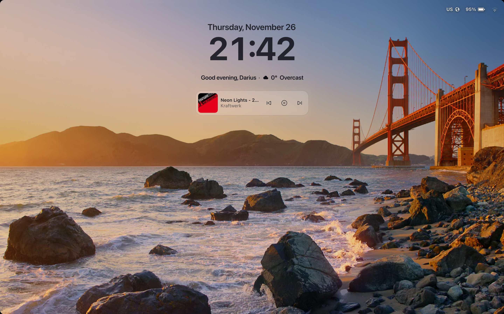

# KVeil

An Apple/macOS-style lock screen shell (`org.darc.lockscreen`) and Kirigami settings app (**KVeil**) for **KDE Plasma 6**, with adaptive backdrop contrast, frosted Now Playing media widget, cached local weather, and optional **Howdy** (Face ID + live IR viewfinder) and **fprintd** (Touch ID-style) status integration.



## Features

- **macOS-style lock screen layout**
  - Bold top clock with configurable 12h/24h format, AM/PM toggle, scale, and visibility (`always`, `prompt`, `never`).
  - Time-of-day greeting + local weather cached via `wttr.in` (`lockscreen-weather.timer`).
  - Frosted-glass MPRIS **Now Playing** widget with cached album art (`lockscreen-mpris-art.service`).
  - Top-right status bar (keyboard layout, battery %, network status) using bundled Breeze symbolic icons.
  - Bottom-aligned user avatar, password pill, idle auto-hide mode, and Sleep / Hibernate / 2-click Shut Down actions.
  - **Adaptive backdrop contrast**: samples wallpaper luminance behind each lock screen zone and switches between light and dark text + contrast halos automatically.
- **Biometric integration (optional)**
  - **Howdy face unlock**: non-interactive PAM status indicator (`Looking for you…`, `Face recognized`, `Face not recognized`, `Camera too dark`) + optional floating **IR Camera Preview** pop-up with 5-point landmark-aligned green tracking brackets.
  - **Fingerprint (`fprintd`)**: Touch ID-style status feedback in the same lock screen layout.
- **KVeil settings GUI**
  - Configure all options live, preview immediately via **Test Lock Screen** (`kscreenlocker_greet --testing`), and inspect system/PAM/helper status.
  - Pick any installed system font or import custom `.ttf` / `.otf` / `.ttc` font files (KVeil does not bundle proprietary fonts; added fonts are installed locally to `~/.local/share/fonts/kveil/`).

## Requirements

- **KDE Plasma 6** (Qt 6, `kscreenlocker`, `qt6-5compat` / `Qt5Compat.GraphicalEffects`, `QtQuick.Effects`)
- **Python 3** with **PySide6** and **PyGObject** (`gi.repository.Gio`)
- **systemd --user** (for the KWin `PLASMA_DEFAULT_SHELL` override and background weather/MPRIS helpers)
- **Optional:** Public **Howdy** (tested with 2.6.1) or **fprintd**

### Installing Dependencies by Distro

- **Arch / CachyOS / EndeavourOS:**
  ```bash
  sudo pacman -S pyside6 qt6-5compat python-gobject
  ```
- **Fedora KDE:**
  ```bash
  sudo dnf install python3-pyside6 qt6-qt5compat python3-gobject
  ```
- **Debian / Ubuntu / KDE Neon:**
  ```bash
  sudo apt install python3-pyside6.qtcore python3-pyside6.qtgui python3-pyside6.qtqml python3-pyside6.qtquickcontrols2 qml6-module-qt5compat-graphicaleffects python3-gi
  ```
  *(Package names vary slightly by release; prefer your distro's `PySide6` packages over `pip` so Qt/Kirigami ABIs match.)*
- **openSUSE Tumbleweed:**
  ```bash
  sudo zypper install python3-pyside6 qt6-qt5compat-imports python3-gobject
  ```

## Installation

```bash
git clone https://github.com/Darius-Varnelis/KVeil.git kveil
cd kveil
chmod +x install.sh uninstall.sh
./install.sh
```

1. Click **Test Lock Screen** inside **KVeil** (or run `PLASMA_DEFAULT_SHELL=org.darc.lockscreen $(qtpaths6 --query QT_INSTALL_LIBEXECS)/kscreenlocker_greet --testing`) to preview immediately.
2. **Log out and log back in** once so KWin picks up the `PLASMA_DEFAULT_SHELL=org.darc.lockscreen` drop-in (`plasmashell` itself is unaffected, so your panels and widgets remain untouched).

## Optional: Howdy Face Unlock & Live IR Viewfinder

KVeil works out of the box with password-only lock screens and `fprintd`. If you use the public **Howdy** package:

1. Configure Howdy in `/etc/pam.d/kde-fingerprint` (and ensure your user can read `/usr/lib/security/howdy` or your distro's Howdy security directory since `kscreenlocker_greet` runs as your user, not root).
2. To enable the live IR camera viewfinder (`IrCameraPopup.qml`), copy the staged `hooks/compare.py` hook (tested against Howdy 2.6.1) using the **Copy sudo command** button inside KVeil's **Status & Unlock → Face & IR** tab:
   ```bash
   sudo install -m 640 ~/.local/share/darc-lockscreen/compare.py /usr/lib/security/howdy/compare.py
   sudo setfacl -m u:$USER:r /usr/lib/security/howdy/compare.py
   ```
   *(Adjust `/usr/lib/security/howdy/compare.py` if your distro installs Howdy under `/lib/security/howdy` or `/usr/lib64/security/howdy` — KVeil auto-detects the path.)*

## Uninstall

```bash
./uninstall.sh          # keeps ~/.config/darc-lockscreen settings
./uninstall.sh --purge  # also removes saved config and cache
```

Log out and log back in afterward to revert KWin to the default Plasma lock screen.

## Notes & Compatibility

- Tested on **KDE Plasma 6.7 / 6.8** (Wayland; X11 drop-in is also installed).
- Because `org.darc.lockscreen` overrides `LockScreenUi.qml` and `MainBlock.qml` from Plasma's desktop shell, major future Plasma 6 releases may require syncing upstream QML changes.
- Original upstream KDE lock screen files carry `GPL-2.0-or-later` / `LGPL-2.0-or-later` headers; see [LICENSE](LICENSE).
